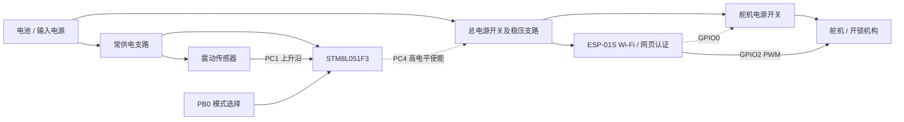

# STM8L + ESP-01S 敲门唤醒门锁改造（v0.2）

> **当前默认烧录行为：PC4 恒高排查测试。** main.c 中 `FORCE_PC4_HIGH_TEST=1` 已开启。初始化时先把 PC4 输出锁存置高，再启用推挽输出；之后持续 RUN，不执行 HALT/WFI，不读取 PB0/PC1、不计时断电、不启用中断或定时器。正常敲门逻辑暂时旁路。
>
> 重新编译、烧录后同时测 PC4、STM8 VDD 和下游电源轨。如果 PC4 稳定高而下游电源仍断续，重点检查电源驱动、稳压和负载；若 STM8 VDD/NRST 异常，检查电源跌落或复位。复位期间引脚由硬件默认状态决定，软件不能保证复位期间也保持高。
>
> 排查完成后将 `FORCE_PC4_HIGH_TEST` 改为 `0` 并重新编译烧录，即恢复下文的上电等待50ms单次模式选择及三次敲门逻辑。ESP8266 核心逻辑不变，其 GPIO0 仍独立控制舵机电源。

> **版本阶段：0.x 内测版 · 第 2 版**
>
>这是“霁泽入微”开源项目，也是从学习到正式的工程转别的思路，本项目是个人制作的实验性门锁改造方案，尚未经过安全认证或长期可靠性验证。请勿将它作为唯一的出入方式，也不要直接用于需要生命安全、消防疏散或高安全等级的场所。

## 项目缘起

起因是某学校宿舍的学生出门时懒得带钥匙，有人一着急、发了脾气，之后便动手改造门锁，就开始动手做一个不用随身带传统钥匙也能操作的方案。

这是一次从真实小麻烦出发的个人软硬件改造。为保护当事人隐私，不公开学校、宿舍及个人身份信息。网页界面由 Mimo 大模型辅助生成；硬件设计和固件软件由项目作者个人所有，并在本仓库按开源协议公开。

## 当前版本

当前版本为 v0.2，由 STM8L051F3 控制 Wi-Fi 和开锁机构总供电。

- PC1 检测上升沿，首次敲门起 10 秒内累计 3 次，相邻有效信号至少间隔 1 秒，低电平稳定确认 30 ms。
- 成功后 PC4 推挽拉高 60 秒，震动不延长供电；无任务时进入 HALT。
- PB0 高为工程/测试模式，持续供电；低为使用模式。上电等待 50 ms 后仅采样一次，模式锁定到下次复位。
- ESP8266 上电启动 Wi-Fi；保留网页密码开锁、管理员配置、舵机动作和配置存储，移除 Wi-Fi 定时启停。

[v0.1 原理结构图](versions/v0.1/docs/architecture.md) · [v0.2 原理结构图与供电排查](versions/v0.2/docs/architecture.md) · [v0.2 接线、编译和测试说明](versions/v0.2/README.md)

## 原理结构图

图为功能结构，完整引脚、状态图及测点见上方链接。STM8 和传感器处于常供电支路。所有信号共地，PC4 接电源开关控制输入；具体 MOS 管和稳压器连接需核对实际 v0.2 电路。

## 仓库内容

- [versions/v0.2/](versions/v0.2/README.md)：当前 STM8 与 ESP8266 源码、测试及接线说明。
- [versions/v0.2/docs/architecture.md](versions/v0.2/docs/architecture.md)：原理结构图、状态图、供电故障排查及验收步骤。
- [versions/v0.1/](versions/v0.1/README.md)：第一版 ESP8266、EPro 工程和原理结构图，旧版电路不代表 v0.2 的全部接线。
- [CHANGELOG.md](CHANGELOG.md)：更新记录。

## 编译与烧录

STM8 使用 STVD + Cosmic，直接打开 [doorup.stw 工作区](versions/v0.2/doorup.stw)，已包含 Debug/Release 配置、STM8L051F3 器件设置和源码引用。工具链预设 E:\stm8l-tools\cosmic\CXSTM8，编译后通过 SWIM 烧录对应目录的 doorup.s19。详见 [构建说明](versions/v0.2/README.md)。

ESP8266 使用 Arduino IDE，打开 versions/v0.2/arduino-esp01s-esp01s-ap-wifi-io0/esp01s_ap_lock/esp01s_ap_lock.ino。IO0 控制舵机供电，IO2 输出 PWM。默认 AP 密码为 88888888、管理员密钥为 888888，首次使用请修改。

ESP8266 已通过 Core 3.1.1 generic 编译。2026-10-18，当前 PC4 恒高诊断代码已使用本机 Cosmic 完成 Debug/Release 编译、链接和 ELF/S19 生成；STVD 内两种配置均为 0 错误、0 警告，另通过主机及网页回归测试。供电稳定性仍需上板确认。

## 供电稳定性

PC4 始终配置为推挽输出，仅在供电状态变化时更新输出锁存。工程模式和 60 秒窗口内保持静态高电平。上电等待 50 ms 期间 PC4 保持低，随后读取 PB0 一次并锁定模式。PB0 中断始终关闭；复位前改变电平不切换模式。测试模式关闭 TIM4 并使用 HALT 保持供电，使用模式等待敲门时也使用 HALT。

尚未取得不稳时的实测波形，不能把现象全部归因于软件。若 PC4 保持高而下游电源掉压，应检查电源开关、稳压器及负载瞬态；若 STM8 VDD 也掉压，应检查常供电支路及复位。具体测点和顺序见 [供电排查说明](versions/v0.2/docs/architecture.md)。

## 安全与使用须知

- 这是实验性门锁控制项目，不是经过认证的防盗或生命安全产品。网络口令、认证方式、机械强度和断电行为均需由使用者自行评估。
- 断电、舵机卡死、网络中断或固件异常时，门锁可能无法按预期动作。保留可从内侧安全离开的方式和可靠的备用开门方案，确保不阻碍消防疏散。
- 实际使用是使用舵机的机械行程，确保门锁正常打开和关闭，不去更改原有锁的机构，知识使用舵机模拟人在门后拨动锁的机构。
- 先在脱离真实门锁的台架上测试，再进行机械安装；确认舵机不会过行程、夹伤人员或损坏门锁。未经许可不要改造他人或公共设施。
- 使用者须遵守所在地法律、学校/物业规定，并取得门锁所有者许可。作者不对安装、使用、改造或故障造成的损失承担保证责任；详见 `LICENSE`。

## 版本规则

版本号采用 `v主版本.次版本` 形式。本项目约定：主版本 `0` 表示内测阶段；`v0.1` 是内测第一版。后续功能增量可使用 `v0.2`、`v0.3`；准备进入正式稳定阶段时再升级主版本号。Git tag 用于标记每个可追溯版本。

## 开源协议与权属

仓库内由项目作者个人创作并拥有权利的固件、网页界面、硬件设计资料及文档，按 MIT License 开源，详见 [`LICENSE`](LICENSE)。网页由 Mimo 大模型辅助生成这一事实在此明确说明；公开仓库不包含学校和当事人的身份信息。若文件中含有第三方素材或依赖，其权利仍归相应权利人所有，并应遵循各自许可。

## 贡献

欢迎通过 Issue 或 Pull Request 提交问题、改进建议和补丁。提交前请检查：没有真实凭据、个人信息或未经授权公开的资料；硬件修改附上清晰接线/电路说明；涉及门锁安全行为的修改提供测试条件与失效模式说明。
