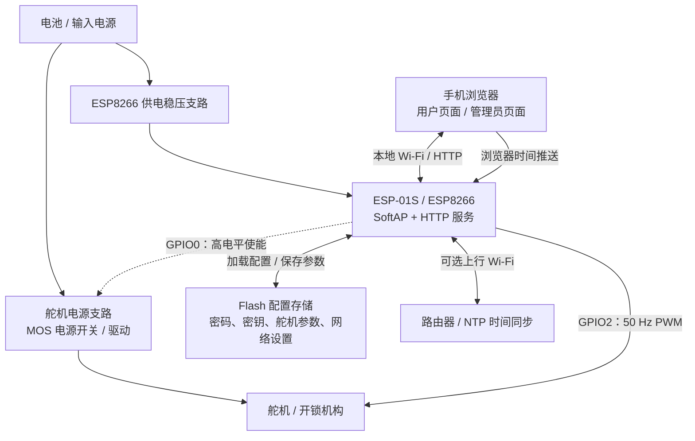
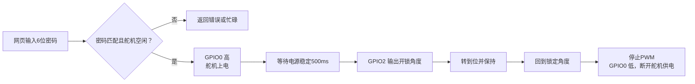

# v0.1 原理结构图

v0.1 使用 ESP-01S 建立本地 Wi-Fi AP，通过网页验证密码后控制舵机开锁。ESP8266 持续连接电源，Wi-Fi 由固件策略启停；电源开关控制舵机支路。

本图根据归档固件绘制，是功能结构图。具体电源电压、稳压器和双 MOS 驱动连接应结合本目录的 EPro 硬件工程核对。

## 电源与控制结构

实线表示电源或数据连接，虚线表示电源使能控制。ESP8266、舵机电源和驱动电路共地；GPIO0 仅控制开关，负载电流不经过 GPIO。

| 引脚 | 归档固件的用途 |
| --- | --- |
| GPIO0 | 舵机电源开关控制，高电平使能 |
| GPIO2 | 舵机 PWM 信号，标称 50 Hz |

引脚以 `esp01s_ap_lock.ino` 的 `PIN_SERVO_PWR=0`、`PIN_SERVO_SIG=2` 为准。部分旧说明/独立页面曾写 IO1，实际归档固件使用 IO2。GPIO0、GPIO2 均涉及 ESP8266 启动配置，外部电路应满足复位启动电平要求。

## 开锁流程

管理员还可进行密码、网络、动作参数配置和手动舵机测试；持久化沿用 Flash 记录轮转存储。图中为自动开锁主流程，动作延时和角度以固件及保存配置为准。

## Wi-Fi 策略

固件按下列优先级决定是否开启 Wi-Fi：

1. 调试模式常开。
2. 时钟未同步时保持开启，允许浏览器推送时间。
3. 已同步且位于配置的常开时段时保持开启。
4. 已有客户端连接时保持开启。
5. 其余情况每 5 分钟开启 1 分钟。

归档源码中 `DEBUG_MODE=1`，上电默认进入调试常开模式，因此正常情况下不会立即表现为周期休眠。Wi-Fi 关闭不等于 ESP8266 整机断电。

## 与 v0.2 的区别

| 项目 | v0.1 | v0.2 正常逻辑 |
| --- | --- | --- |
| 唤醒来源 | ESP8266 软件 Wi-Fi 策略 | STM8L051F3 检测震动敲门 |
| 总供电控制 | ESP8266 持续供电 | STM8 PC4 控制 Wi-Fi 和机构总供电 |
| 使用窗口 | Wi-Fi 定时 / 时段策略 | 10秒内三次敲门后供电60秒 |
| 模式选择 | ESP8266 调试配置 | 上电等待50ms后单次读取 PB0，锁定至复位 |
| 舵机控制 | ESP GPIO0 电源、GPIO2 PWM | 保留相同控制逻辑 |

v0.2 当前默认开启 PC4 恒高诊断宏，正常逻辑暂时旁路，详见 [v0.2 说明](../../v0.2/README.md)。
