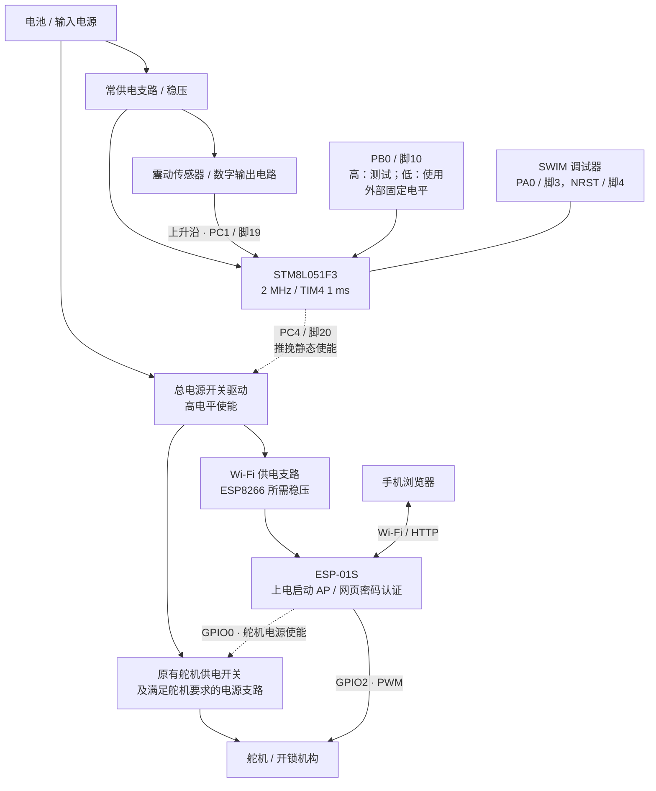
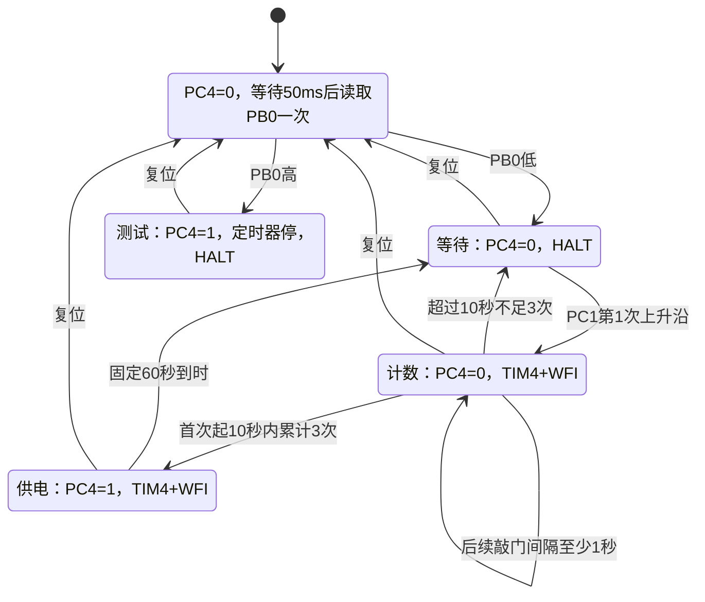

# v0.2 原理结构与供电排查

> 当前 main.c 默认开启 `FORCE_PC4_HIGH_TEST=1`，仅执行 PC4 推挽恒高、CPU持续RUN的诊断路径。下文状态图描述将宏恢复为0后的正常固件；诊断测试时 PB0、PC1、定时器及睡眠逻辑均不参与供电控制。测试需重新编译烧录，复位期间的引脚电平仍取决于硬件。

这是依据固件引脚和功能绘制的系统原理结构图。仓库中的 EPro 工程是 v0.1 硬件归档，尚未提供 v0.2 的完整电路，因此图中的电源开关、稳压器和传感器为功能模块，不代表已经核实的器件型号或 MOS 管接法。

## 电源和控制结构

实线标出电源及信号流向，虚线为电源使能控制。

STM8 和震动传感器必须处于总开关之前的常供电支路，否则无法在 Wi-Fi 断电后继续检测敲门。各模块信号参考地需共地。PC4 驱动的是电源开关的控制输入，Wi-Fi 和舵机负载电流通过电源支路流动。

PB0 必须在上电后的 50 ms 单次采样时有确定电平。固件未使能 PB0 内部上拉，硬件应把它明确接到 STM8 的 VDD 或 GND；若使用断开即悬空的开关，需要外部偏置电阻。这不是连续稳定性检测，悬空时采样结果不可靠。模式选择后锁定到下次复位。

当前用户使用杜邦线选择模式：测试时 PB0 接 **STM8 的 VDD**，使用时接 **GND**。检查杜邦线两端是否插紧、接点是否可靠，避免只连接 PB0 一端或插到已被总开关断电的电源节点。模式参考电平应来自 STM8 的常供电域。

## 软件状态和时序

- PC4 输出模式：`PC_DDR bit4=1`、`PC_CR1 bit4=1`，即推挽输出。`PC_CR2 bit4=0` 是慢速输出设置，不是关闭高电平驱动。
- PC4 的 ODR 锁存值只在供电状态切换时更新。测试模式和 60 秒窗口内保持高电平，不输出 PWM，也不周期性拉低。
- 上电后先等待 50 ms，PC4 保持低、PC1 中断关闭；第 50 个 TIM4 节拍读取 PB0 一次。锁定后关闭 PB0 中断，运行中不再读 PB0。
- 测试模式停止 TIM4，执行 HALT 保持 PC4 高；使用模式无任务时也执行 HALT。HALT/WFI 本身会保留 GPIO 输出值。
- 使用模式的 60 秒从第三次有效敲门开始。采样后 PB0 的任何变化都不重置计时、不切换模式；只有复位重新选择模式。

## 电平不稳的定位方法

软件核查发现原版 PB0 原始读数参与运行时模式切换，可能导致跳变触发断电。本版按用户要求改为上电等待 50 ms 后单次采样，随后锁定至复位，取消运行时模式切换。尚无实板波形，不能确认板上供电不稳的全部原因。

先将 PB0 固定在 STM8 VDD 测试常供电，再分别观测下表信号；测量参考地使用 STM8 的 VSS。优先用示波器观察瞬时变化，万用表可能只显示平均值。

| 测点 / 现象 | 排查方向 |
| --- | --- |
| PC4 持续接近 STM8 VDD，下游电源掉压 | 总电源开关驱动、MOS 导通条件、稳压器瞬态能力、电源内阻、舵机启动电流和回流路径 |
| PC4 与 STM8 VDD 同时跌落 | 常供电支路压降、共用电源受负载冲击、去耦和地线压降；MCU 可能反复复位 |
| STM8 VDD 稳定，PC4 高低切换 | 同时观察 PB0、NRST，检查是否复位；新版本运行中PB0不参与模式切换；核对烧录版本 |
| STM8 VDD 稳定，PC4 中间电压 | 检查 PC4 外部负载是否过重、驱动输入是否钳位/短路，核对引脚、DDR、CR1、ODR |
| 无负载 PC4 正常，接负载后异常 | 分别接入 Wi-Fi、舵机电源支路，定位冲击来源 |

建议分三步验证：先保持电源开关控制连接、断开 Wi-Fi 和舵机负载；再接 Wi-Fi；最后接舵机。每步记录 PC4、STM8 VDD 和下游电源轨，明确是控制电平变化还是功率电源掉压。

## 上板验收

1. 更新 `main.c` 后重新 Cosmic Debug 编译及烧录；之前的 0 错误、0 警告记录对应修改前版本，本次上电模式锁定修改需要重新编译确认。
2. PB0 固定高电平，PC4 应持续高，观察至少 2 分钟并测试网页、Wi-Fi 及舵机负载。
3. PB0 低，0、1、2 秒敲门；第三次后 PC4 应连续高约 60 秒，只在结束时下降。
4. 测试模式采样完成后把 PB0 改为低，PC4 仍应保持高，直至复位；低电平复位后等待50ms，应转为使用模式。
5. 使用模式采样完成后把 PB0 改为高，再完成三次敲门，仍应只供电60秒；高电平复位后等待50ms，应转为测试模式。
6. 确认供电稳定后断开调试器测 HALT 电流；测试模式关闭 TIM4，但下游电源保持开启，整机电流包含 Wi-Fi 等负载。
